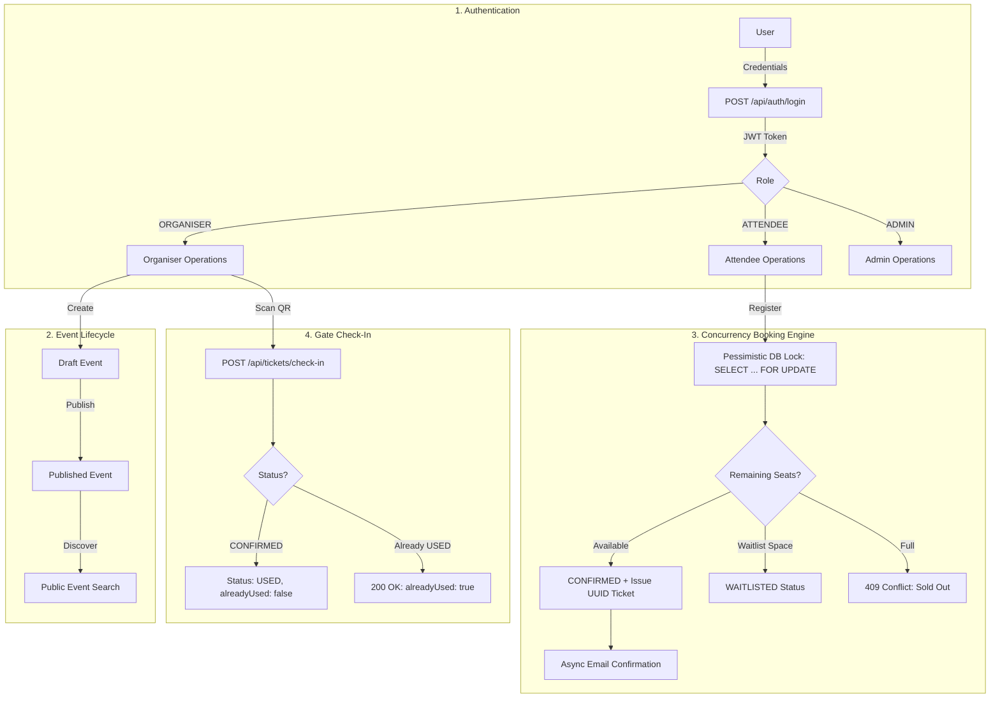

# 🎟️ High-Concurrency Event Registration & Ticketing Platform

A production-grade, distributed Event Management & Ticketing backend built with **Java 21**, **Spring Boot 3**, **MySQL 8**, **Redis**, and **Docker**. Engineered to handle high-concurrency seat bookings, race conditions, automated waitlist promotions, and idempotent gate ticket check-ins.

---

## 🌟 Key Engineering Highlights

* **Thread-Safe Seat Booking (Pessimistic Locking):** Uses `SELECT ... FOR UPDATE` row-level locks in MySQL during registration to strictly prevent overselling seats when hundreds of attendees register simultaneously.
* **Optimistic Locking (`@Version`):** Event entities employ JPA optimistic locking to detect and prevent conflicting concurrent organiser updates.
* **Auto-Waitlist Cascade:** If capacity is reached, attendees are automatically queued into a waitlist. When an attendee cancels, the system automatically and synchronously promotes the earliest waitlisted attendee and issues them a ticket.
* **Idempotent Gate Check-In:** Venue gate scanners call `/api/tickets/check-in`. Scanning an already used ticket returns `200 OK` with `alreadyUsed: true` instead of failing, preventing double-scan exceptions and duplicate admissions.
* **Resilient Async Email Pipeline:** Confirmation emails are sent asynchronously (`@Async`). If mail delivery fails, failed entries are stored in an `email_retry_queue` table and automatically retried with exponential backoff.
* **Role-Based Access Control (RBAC):** Stateless JWT authentication with roles:
  * `ORGANISER`: Create, publish, manage events, and scan tickets at gates.
  * `ATTENDEE`: Browse events, register (individual & team), view tickets.
  * `ADMIN`: Platform-wide event oversight, real-time analytics, and revenue metrics.

---

## 🛠️ Technology Stack

| Layer | Technology |
|---|---|
| **Language** | Java 21 (LTS) |
| **Framework** | Spring Boot 3.3.4 |
| **Security** | Spring Security 6 + JJWT (Stateless JWT Bearer Auth) |
| **Persistence** | Spring Data JPA / Hibernate |
| **Database** | MySQL 8.0 |
| **Migrations** | Flyway (`V1__init_schema.sql`, `V2__add_event_version.sql`) |
| **Cache & Sessions**| Redis 7 (Token store, verification codes, refresh tokens) |
| **Documentation**| OpenAPI 3 / Swagger UI |
| **Testing** | Postman Collection v2.1 + JUnit 5 / Testcontainers |
| **Containerization**| Docker & Docker Compose |

---

## 🏗️ System Architecture & Workflow



---

## 🗄️ Database Schema & Entities

The relational database (`eventdb`) contains 7 core tables:

1. **`users`**: Account credentials (BCrypt hashed), verification flags, and roles (`ORGANISER`, `ATTENDEE`, `ADMIN`).
2. **`events`**: Event information, status (`DRAFT`, `PUBLISHED`, `CANCELLED`), capacity limits, waitlist caps, price, and version token.
3. **`registrations`**: Individual registrations linked to user and event with status (`CONFIRMED`, `WAITLISTED`, `CANCELLED`).
4. **`tickets`**: Issued tickets containing a unique UUID token, status (`CONFIRMED`, `USED`, `CANCELLED`), and gate check-in timestamps.
5. **`team_registrations`**: Group bookings linking multiple attendee registrations to a single team name.
6. **`email_retry_queue`**: Background queue for transient email delivery failures with retry attempt counters.
7. **`flyway_schema_history`**: Database migration records tracking versioned schema rollouts.

---

## 🚀 Getting Started

### 1. Prerequisites
* **Java 21** or higher
* **Docker & Docker Compose**

### 2. Start Infrastructure (MySQL & Redis)
Run Docker Compose in the project root:
```bash
docker-compose up -d
```
* MySQL runs on port `3306` (database: `eventdb`, user: `root`, pass: `root`).
* Redis runs on port `6379`.

### 3. Run the Spring Boot Application
```bash
./mvnw spring-boot:run
```
The server will start at: `http://localhost:8080`.

---

## 🧪 Interactive Testing & Endpoints

### 1. Swagger UI (OpenAPI Documentation)
Access the interactive API browser:
👉 [http://localhost:8080/swagger-ui/index.html](http://localhost:8080/swagger-ui/index.html)

### 2. Ready-to-Use Test Accounts
| Role | Email | Password |
|---|---|---|
| **ORGANISER** | `alice@test.com` | `password123` |
| **ORGANISER** | `anmolgakhar2@test.com` | `Anmol@123` |
| **ATTENDEE** | `bob@test.com` | `password123` |
| **ADMIN** | `admin@test.com` | `password123` |

---

### 3. API Cheatsheet

#### Authentication (`/api/auth`)
* `POST /api/auth/register` — Register a new account.
* `POST /api/auth/login` — Log in and receive JWT `accessToken` & `refreshToken`.
* `GET  /api/auth/verify-email?token=` — Email verification link.
* `POST /api/auth/refresh` — Issue fresh access token using refresh token.

#### Events (`/api/events`)
* `GET    /api/events` — **Public:** View all published events.
* `GET    /api/events/{id}` — **Public:** View single event details.
* `POST   /api/events` — **ORGANISER:** Create a new event (`DRAFT`).
* `PUT    /api/events/{id}/publish` — **ORGANISER:** Publish event for registration.
* `PUT    /api/events/{id}/cancel` — **ORGANISER:** Cancel event and notify attendees.
* `GET    /api/events/mine` — **ORGANISER:** View all events created by me.

#### Registrations (`/api/registrations`)
* `POST   /api/registrations/{eventId}` — **ATTENDEE:** Register for an event (issues ticket).
* `POST   /api/registrations/{eventId}/team` — **ATTENDEE:** Register as a team.
* `GET    /api/registrations/my` — **ATTENDEE:** View all my registered events and tickets.
* `DELETE /api/registrations/{id}` — **ATTENDEE:** Cancel registration (auto-promotes waitlist).

#### Tickets & Venue Check-In (`/api/tickets`)
* `GET    /api/tickets/{token}` — View ticket details & QR metadata.
* `POST   /api/tickets/check-in?token={token}` — **ORGANISER:** Gate QR check-in (Idempotent).

#### Admin Dashboard (`/api/admin`)
* `GET    /api/admin/events` — **ADMIN:** Global platform event listings.
* `GET    /api/admin/events/{eventId}/stats` — **ADMIN:** Real-time analytics (capacity, confirmed, waitlisted, checked-in, revenue).
* `POST   /api/admin/events/{eventId}/cancel` — **ADMIN:** Administrative event cancellation override.

---

## 📮 Postman Collection

A pre-configured, automated Postman Collection is included in the root directory:
* [`Event_Registration_Platform.postman_collection.json`](./Event_Registration_Platform.postman_collection.json)

**How to use:**
1. Open Postman ➔ Click **Import** ➔ Select `Event_Registration_Platform.postman_collection.json`.
2. Follow folders `01` through `06` in sequential order.
3. Postman test scripts will automatically capture Bearer tokens, Event IDs, and Ticket tokens into collection variables!

---

## 📦 Running Tests
Execute the unit and integration test suite:
```bash
./mvnw clean test
```
